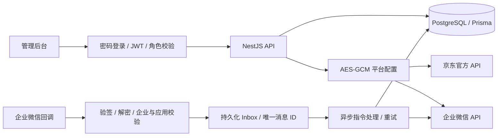

# 真实数据版本 · 0.2

## 数据流

本轮删除 `store.ts` 和示例用户/订单。所有管理 API 以数据库为数据源。没有外部凭证时不回退到 Mock。

## 平台配置 API

所有路径前缀 `/api/v1`。

- `POST /auth/login`：email + password，数据库密码哈希验证；不接收角色选择。
- `GET /integrations/jd`、`GET /integrations/wecom`：字段标签、普通字段值、密钥 configured 标志、最后测试结果。
- `PUT /integrations/:kind`：仅超级管理员，密钥空值保留原值，AES-GCM 使用 provider-specific AAD 加密，保存动作与审计同一事务。
- `POST /integrations/:kind/test`：调用京东分类接口或企业微信 access_token 接口；返回实际错误码或成功结果。测试不会发送企业微信通知。
- `GET /service-status`：不含配置明文，仅返回配置/连接状态。
- `GET /callbacks/wecom` / `POST /callbacks/wecom`：公网 HTTPS 回调入口；消息身份不能由浏览器声明。
- 原有业务列表、规则、审核 API 保留，改为 Prisma 查询/事务。

## 订单字段

`platform` 独立表示京东/淘宝/拼多多等来源；`externalOrderId` 按字符串存储。金额与实付分别存储；返现比例来自 `ruleSnapshot.basisPoints`，不读取最新全局规则改写历史。下单/完成时间用 DateTime，展示北京时间 `YYYY-MM-DD HH:mm:ss`。

标准状态支持 CREATED（待付款）、COMPLETED（已完成）、CANCELLED（已取消），以及必要的已付款/退款/待核实等状态。源平台状态不明时不猜测。不把订单归属未知自动视为已取消或已完成。

京东订单查询当前拉取最近 1 小时更新时间窗，最多 20 页；保存复合唯一键（平台/账号/订单号/订单行号）并幂等更新。尚未验证的价格、实付和完成字段保持 null。原始计佣金额与状态保存在 rawData，不能冒充实付。后续需授权账号验证映射、可靠用户追踪、增量游标与补偿任务。

## 资金与权限

真实审核通过只变更为待打款；拒绝通过事务释放冻结余额；确认人工打款要求凭证编号。Serializable 事务 + 钱包/申请版本检查 + 唯一资金业务键防重复。资金分桶变动分别记账。真实收款资料及用户申请流程尚未开放，系统不会自动转账。

SUPER_ADMIN 可配置密钥，ADMIN/FINANCE 不可读写平台配置；FINANCE 只读及提现操作。JWT 验证后再次查询账户启用状态。登录错误统一响应、失败次数限频。配置主密钥和 JWT 签名密钥来自服务端环境变量，业务密钥来自数据库。

## 官方文档与验证边界

- [京东联盟官方开放平台](https://union.jd.com/openplatform/api)：页面提示旧 router.jd.com 网关已停止维护，因此代码使用新版 `api.jd.com/routerjson`。
- [京东官方网关调用说明](https://open.healthjd.com/docs/接入指南/开放平台-调用API/)：用于核对网关、系统参数及业务参数封装；联盟特定方法仍需在授权文档和真实账户中核对。
- [企业微信官方回调文档](https://developer.work.weixin.qq.com/document/path/90930)、[消息加解密](https://developer.work.weixin.qq.com/document/path/90968)。

京东联盟的完整接口详情需要登录，当前未登录用户账号。代码中的方法和状态映射不代表账户授权已验证；在后台配置凭证后应逐项联调。未实现可靠归属前禁止自动返现。
